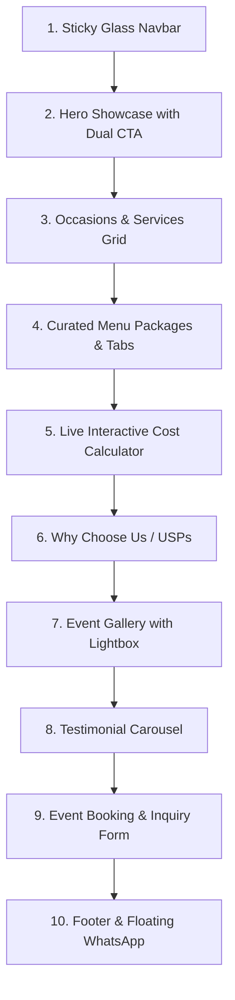

# 🍽️ Master Plan: Luxury Catering Single-Page Website

> **Quick Context for Any AI / Developer:**  
> This project is a **high-converting, modern, single-page Catering Landing Page** built strictly using **HTML5, CSS3, and Vanilla JavaScript (ES6+)** with zero external framework dependencies. It features smooth micro-animations, an interactive catering cost calculator, dynamic testimonial carousel, filterable menu packages, and an event inquiry booking form.

---

## ⚡ 1. Project At-a-Glance (30-Second Summary)

| Parameter | Specification |
| :--- | :--- |
| **Project Location** | `catering-website/` directory |
| **Project Type** | Single-Page Responsive Landing Page (Catering & Hospitality) |
| **Tech Stack** | Pure HTML5 + Vanilla CSS3 + Vanilla JavaScript (No React/Tailwind/Bootstrap) |
| **Design Vibe** | Warm Luxury, Culinary Elegance, Glassmorphism, Micro-interactions |
| **Primary Goal** | Showcase catering services, build instant trust, calculate estimates, convert inquiries |
| **Target Audience** | Weddings, Corporate Events, Private Celebrations, Birthday/Anniversary Parties |
| **Key Differentiator**| Real-Time Live Catering Cost Estimator + Rich Interactive Carousel & Lightbox |

---

## 🎨 2. Design System & Style Guide

### Color Palette (Culinary Luxury)
```css
:root {
  --primary: #c59b27;        /* Warm Royal Gold / Saffron Accent */
  --primary-hover: #b0881e;  /* Deep Gold */
  --secondary: #e2725b;      /* Terracotta / Appetite Warmth */
  --dark-bg: #141414;        /* Rich Black Background for Contrast */
  --card-bg: #1e1e1e;        /* Dark Surface Elevation */
  --light-bg: #fcfbf7;       /* Soft Cream / Off-white for light sections */
  --text-dark: #1b1b1b;      /* High contrast dark text */
  --text-light: #f5f5f5;     /* High contrast light text */
  --text-muted: #8e8e93;     /* Muted metadata / captions */
  --glass: rgba(255, 255, 255, 0.08); /* Frosted Glass backdrop */
  --glass-border: rgba(255, 255, 255, 0.15);
}
```

### Typography
* **Headings:** `'Playfair Display', serif` (Elegance & prestige)
* **Body & UI:** `'Outfit', sans-serif` or `'Inter', sans-serif` (Crisp, clean readability)

---

## 🏛️ 3. Folder & File Structure
```text
catering-website/
├── index.html               # Semantic, SEO-optimized single-page structure
├── CATERING_PLAN.md         # This master blueprint document
├── css/
│   └── style.css            # Modular CSS (Tokens, Reset, Layout, Components, Animations)
├── js/
│   └── main.js              # Vanilla JS (Calculator, Carousel, Filter, Lightbox, Form)
└── assets/
    ├── images/              # Optimized WebP/PNG food & event photos
    └── icons/               # SVG vector icons
```

---

## 📑 4. Section-by-Section Architecture (10 Sections)



### 1. Sticky Navbar
* **Visuals:** Transparent on top, transforms into frosted glass (`backdrop-filter: blur(12px)`) on scroll.
* **Items:** Logo, Navigation Links (*Services, Menu, Calculator, Gallery, Reviews*), Call Hotline button, and `"Book Event"` CTA.
* **Mobile:** Smooth hamburger drawer slide-out.

### 2. Hero Section
* **Headline:** *"Crafting Unforgettable Feasts for Life's Grandest Moments"*
* **Sub-headline:** Premium bespoke catering for weddings, corporate galas, and intimate celebrations with five-star culinary perfection.
* **Dual CTA:** `Explore Menus` (smooth scroll) & `Get Instant Estimate` (scrolls to calculator).
* **Social Proof Counter:** `500+ Events Catered` | `4.9 ★ (300+ Reviews)` | `100% Chef-Crafted`.

### 3. Occasions & Services (Card Grid)
* **Wedding Catering:** Grand royal buffets, live interactive counters, plated service.
* **Corporate Galas:** Business conferences, lunches, networking dinners, high-tea setups.
* **Private Parties:** Birthdays, anniversaries, housewarmings, cocktail parties.
* **Live Thematic Counters:** Chaat street, Italian wood-fired, live barbecue, artisanal desserts.
* *Animation: Hover card lift with soft golden glow effect.*

### 4. Curated Menu Packages (Interactive Filter Tabs)
* **Tabs:** `All` | `Royal Wedding` | `Corporate Executive` | `Cocktail & Live Bites`
* **Package Cards:**
  * Package Name & Price per plate guide
  * Welcome Drinks, Appetizers count, Main Course spread, Breads, Desserts
  * `"Select for Quote"` button that pre-fills the calculator!

### 5. Live Interactive Catering Cost Calculator 🔥 (Hero Feature)
* **Sliders / Inputs:**
  * Guest Count Slider (25 to 1,000+ guests)
  * Package Tier (Standard / Royal / Luxury)
  * Add-ons checkboxes (Live Mocktail Bar, Dessert Fountain, Premium Plating, Uniformed Butler Service)
* **Live Result Box:** Real-time calculated estimate (e.g., `Estimated: $2,400 - $2,800`) with a button: `"Lock This Quote"`.

### 6. Why Choose Us / USPs
* **Master Chefs:** Certified executive chefs with 15+ years culinary mastery.
* **Farm-to-Table:** Organic, fresh, locally sourced farm ingredients.
* **Hygiene & Standards:** 100% certified clean kitchen & white-glove event handling.
* **Custom Dietary Options:** Dedicated Jain, Halal, Vegan, and Gluten-Free setups.

### 7. Event & Food Gallery (Filterable + Lightbox Modal)
* Filter by: `All` | `Buffet Setups` | `Plated Dishes` | `Live Counters`
* Click on any picture opens a full-screen **Lightbox Modal** with smooth zoom animation.

### 8. Client Testimonials (Dynamic Carousel)
* Smooth slide animation showing customer review, photo, event type (e.g., "Rohit & Priya's Wedding"), and 5-star ratings.
* Next/Prev buttons + auto-slide every 5 seconds + touch swipe support.

### 9. Event Booking & Inquiry Form
* Fields: Full Name, Phone / WhatsApp, Email, Event Date, Expected Guest Count, Occasion Type, Message.
* Instant client-side validation with a celebratory success message banner on submit.

### 10. Footer & Floating Quick Actions
* Company bio, service coverage areas, quick navigation, social links.
* **Sticky Floating Action Button (FAB):** Quick WhatsApp direct chat button on bottom-right corner.

---

## 🚀 5. Performance & Quality Standards
1. **Zero External Heavy Frameworks:** Pure HTML/CSS/JS means page loads in under 1 second.
2. **Mobile First Responsive:** Flawless display on 320px mobile up to 4K ultra-wide screens.
3. **SEO Optimized:** Semantic HTML5 (`<header>`, `<nav>`, `<main>`, `<section>`, `<footer>`), OpenGraph tags, proper heading hierarchy.
4. **Fluid Micro-Animations:** CSS transitions, CSS keyframe pulses, and IntersectionObserver for effortless scroll-fade animations without lag.
